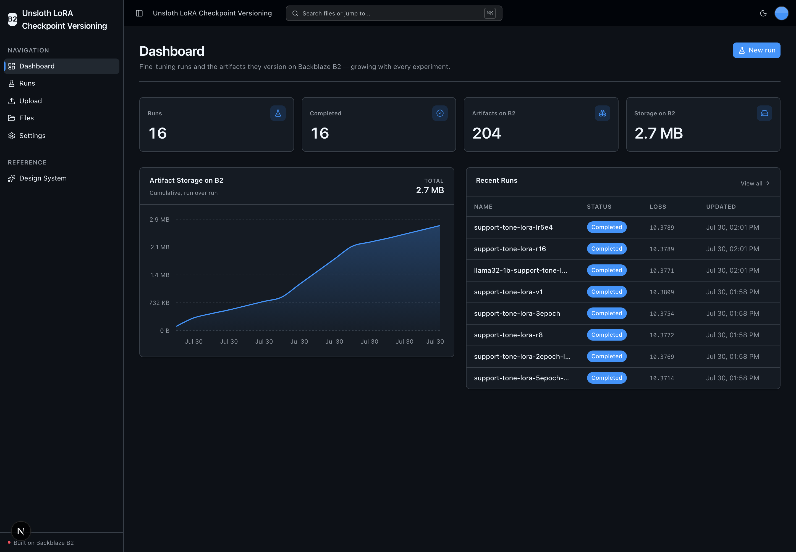
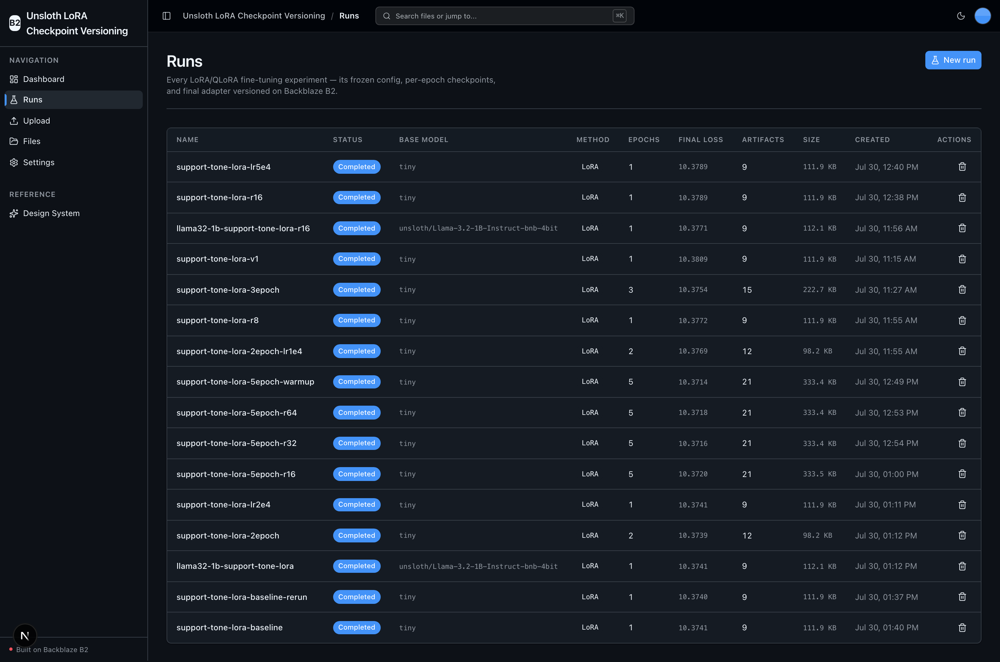
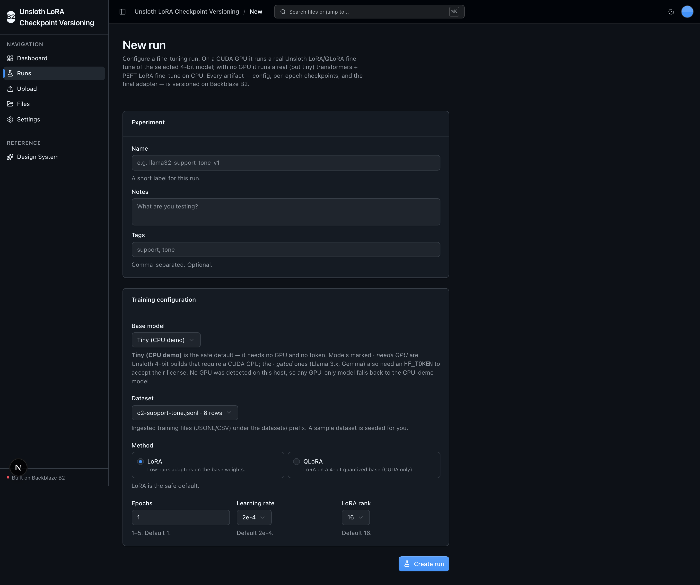
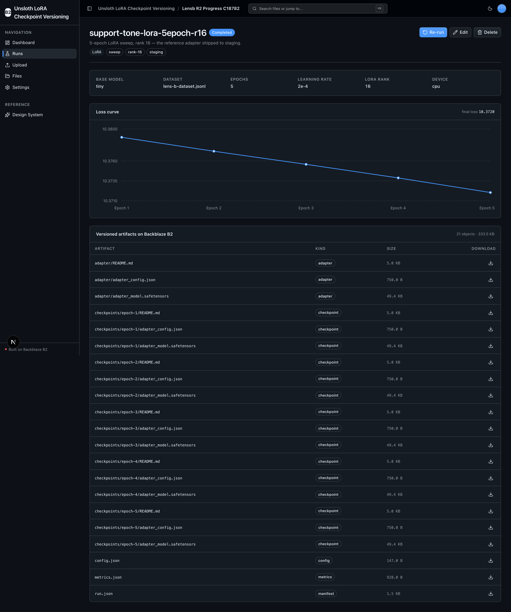

<!-- last_verified: 2026-07-29 -->
# Unsloth LoRA Checkpoint Versioning

An MLOps experiment-tracking dashboard for local **LoRA/QLoRA fine-tuning with
[Unsloth](https://github.com/unslothai/unsloth)**, where every artifact a run
produces — the training dataset, per-epoch checkpoints, the final adapter, the
frozen training config, and the metrics — is **versioned on
[Backblaze B2](https://www.backblaze.com/sign-up/ai-cloud-storage?utm_source=github&utm_medium=referral&utm_campaign=ai_artifacts&utm_content=b2ai-unsloth-lora-checkpoint-versioning)**
under a run-keyed prefix. It is for ML engineers and researchers running
fine-tuning experiments on open-weight models (Llama / Qwen / Gemma) on a single
GPU who need reproducible, rollback-able, shareable run artifacts without
standing up a heavyweight MLOps stack.

B2 is the remote artifact store for the entire loop — ingest → train →
checkpoint → archive → serve/query — accessed via the S3-compatible API with a
custom user agent and standard `B2_*` env vars. The value it shows off: a **real
accumulating-artifact curve** that grows with every experiment sweep — datasets,
adapters, checkpoints, and configs piling up run over run.

### The 5-step workflow

1. **Ingest a dataset** — upload a JSONL/CSV training file on the Upload page; it
   lands on B2 under `datasets/`. (A tiny sample dataset is seeded for you.)
2. **Configure a run** — pick a base model, dataset, method (LoRA/QLoRA), epochs,
   learning rate, and LoRA rank on `/runs/new`. The config is frozen to B2 as
   `runs/<run_id>/config.json`.
3. **Start training** — one click launches the fine-tune in the background. Each
   epoch snapshots a checkpoint to `runs/<run_id>/checkpoints/epoch-<n>/`.
4. **Watch checkpoints land on B2** — live progress and a loss curve update in
   place; the final adapter + `metrics.json` are archived when training finishes.
5. **Browse / compare / download** — compare runs in the list, then presigned-
   download any versioned checkpoint or adapter from the scoped artifact explorer.

### GPU vs CPU — a real fine-tune either way

Device is **auto-detected at runtime** (first available of CUDA → CPU; the CPU
default never requires a GPU):

- **CUDA GPU present** → a real **Unsloth `FastLanguageModel`** LoRA/QLoRA
  fine-tune of the selected 4-bit base model (the vendor's own engine).
- **No GPU** (including Apple Silicon — Unsloth has no Apple-MPS path) → a real
  but minimal **transformers + PEFT LoRA** fine-tune of a tiny CPU-friendly
  causal LM. This produces genuine LoRA adapter safetensors, a real loss curve,
  and real per-epoch checkpoints — not a mock — so the full B2 versioning loop is
  verifiable on a GPU-less host.

**Cost: $0 per run.** No AI-provider key, no paywall — only B2 credentials. Base
weights pull from Hugging Face; **gated** models (Llama 3.x, Gemma) need an
optional `HF_TOKEN` to accept their license and a CUDA GPU. The default CPU-demo
model is ungated, so the demo needs no token.

## What it looks like

**Dashboard** — MLOps metrics (total runs, completed, artifacts on B2, storage) alongside the cumulative artifact-storage curve that grows run over run.



**Runs** — every LoRA/QLoRA fine-tuning experiment in one table: status, base model, method, epochs, final loss, artifact count, and size on B2.



**New run** — configure a fine-tune (base model, dataset, LoRA/QLoRA method, epochs, learning rate, LoRA rank); the config is frozen to B2 as `runs/<run_id>/config.json`.



**Run detail** — the frozen config, the per-epoch loss curve, and a scoped artifact explorer listing everything under `runs/<run_id>/` on B2 with presigned downloads.



## Agent-First Architecture

This repo is optimized for coding agents. Use the template, point your agent at it, and start building.

The structure follows the principle that **repository knowledge is the system of record**. Anything an agent can't access in-context doesn't exist — so everything it needs to reason about the codebase is versioned, co-located, and discoverable from the repo itself.

### How it works

**[AGENTS.md](AGENTS.md) is the single source of truth for all coding agents.** Its bounded, agent-sized entry point gives agents the repository layout, architectural invariants, commands, conventions, and pointers to deeper docs. Agent-specific files (CLAUDE.md, GEMINI.md, Copilot instructions, etc.) are thin pointers back to AGENTS.md.

**Architecture is enforced mechanically, not by convention.** Layering rules, import boundaries, file size limits, and SDK containment are verified by structural tests and lints that run on every change. When rules are enforceable by code, agents follow them reliably.

**The knowledge base is structured for progressive disclosure:**

```
AGENTS.md              Single source of truth — layout, invariants, commands, conventions
ARCHITECTURE.md        System layout, layering rules, data flows
docs/
  features/            Feature docs (inputs, outputs, flows, edge cases)
  app-workflows.md     User journeys
  dev-workflows.md     Engineering workflows and testing
  SECURITY.md          Security principles
  RELIABILITY.md       Reliability expectations
  exec-plans/          Execution plans and tech debt tracker
```

### Key design decisions

| Principle | Implementation |
|-----------|---------------|
| Give agents a single source of truth | AGENTS.md — bounded layout, invariants, commands, conventions |
| Enforce invariants mechanically | Structural tests + ruff + ESLint verify boundaries |
| DRY documentation | Each fact lives in one place; no redundant files to drift |
| Strict layered architecture | `types -> config -> repo -> service -> runtime`, enforced by tests |
| Prefer boring, composable libraries | stdlib logging over frameworks, Pydantic over ad-hoc validation |
| Contain external SDKs | `boto3` only in `repo/` layer — verified by structural test |
| Keep files agent-sized | 300-line limit per file, enforced by test |
| Docs updated with code | Same-PR requirement prevents documentation rot |
| Structured observability | JSON logging, `/metrics` endpoint, request tracing |

This approach draws from [OpenAI's experience building with Codex](https://openai.com/index/harness-engineering/): agents work best in environments with strict boundaries, predictable structure, and progressive context disclosure.

## Quick Start

You need: Node.js >= 20, pnpm >= 9, Python >= 3.11, and a free **[Backblaze B2 account](https://www.backblaze.com/sign-up/ai-cloud-storage?utm_source=github&utm_medium=referral&utm_campaign=ai_artifacts&utm_content=b2ai-unsloth-lora-checkpoint-versioning)**.

### Supported local environments

Local scripts are supported on macOS, Linux, and WSL2. Native Windows is not
supported yet because the dev scripts use POSIX shell syntax and
`services/api/.venv/bin/*` paths; use WSL2 on Windows.

Cloud or sandboxed coding-agent environments also need permission for dependency
downloads during `pnpm run setup`. Running the app or Playwright E2E requires
localhost server binding for the web server on port 3000 and the API on
8000-8009, plus permission to launch the Playwright Chromium browser. If a
sandbox denies binding, `pnpm run doctor` and `scripts/pick-port.mjs` report
`EPERM`/`EACCES` as a permissions issue instead of a busy port. A host without
IPv6 (many containers) is not treated as a failure — the IPv4 probe decides.

### Start a new project

**Option 1: GitHub Template (recommended)**

Click the green **"Use this template"** button at the top of this repo, name your project, then:

```bash
git clone https://github.com/yourorg/my-cool-app.git
cd my-cool-app
```

**Option 2: Clone and reinitialize**

```bash
git clone https://github.com/backblaze-b2-samples/unsloth-lora-checkpoint-versioning.git my-cool-app
cd my-cool-app
rm -rf .git
git init
git add .
git commit -m "Initial commit from unsloth-lora-checkpoint-versioning"
```

Either way you get a clean project with no upstream history — ready to push to your own repo and point your agent at it.

### Setup

**1. Run setup**

```bash
pnpm run setup
```

This copies `.env.example` to `.env` only when `.env` does not already exist,
installs workspace dependencies from `pnpm-lock.yaml`, creates
`services/api/.venv` if missing, and installs the API's committed Python 3.11
resolution from `services/api/requirements.lock`. It is safe to rerun and never
overwrites an existing `.env`.

> Use the `pnpm run` form: `setup` (like `doctor`) is a built-in pnpm command
> before pnpm 11, so bare `pnpm setup` would run pnpm's own command instead of
> this script.

**2. Add your B2 credentials**

Open `.env` in your editor and keep it visible. Then head to the [Backblaze B2 dashboard](https://secure.backblaze.com/b2_buckets.htm?utm_source=github&utm_medium=referral&utm_campaign=ai_artifacts&utm_content=b2ai-unsloth-lora-checkpoint-versioning) and:

1. **Create a bucket.** B2 will show these values — paste each into `.env`:
   - **Bucket Unique Name** → `B2_BUCKET_NAME`
   - **Region** (the `<region>` in the S3 endpoint `s3.<region>.backblazeb2.com`, e.g. `us-west-004`) → `B2_REGION`
2. **Create an application key** with `Read and Write` permission. B2 will show two values — paste each into `.env`:
   - **keyID** → `B2_APPLICATION_KEY_ID`
   - **applicationKey** → `B2_APPLICATION_KEY` *(only shown once — paste it now)*

The five standard keys are `B2_APPLICATION_KEY_ID`, `B2_APPLICATION_KEY`,
`B2_BUCKET_NAME`, `B2_REGION`, and the optional `B2_PUBLIC_URL_BASE` (public
buckets only). Fine-tuning is fully local — no AI-provider key is needed; set the
optional `HF_TOKEN` only to pull gated base models (Llama 3.x, Gemma) on a GPU.

> Want a walkthrough? See the docs for [creating a bucket](https://www.backblaze.com/docs/cloud-storage-create-and-manage-buckets?utm_source=github&utm_medium=referral&utm_campaign=ai_artifacts&utm_content=b2ai-unsloth-lora-checkpoint-versioning) and [creating app keys](https://www.backblaze.com/docs/cloud-storage-create-and-manage-app-keys?utm_source=github&utm_medium=referral&utm_campaign=ai_artifacts&utm_content=b2ai-unsloth-lora-checkpoint-versioning).

**3. Run it**

```bash
pnpm dev
```

That's it. Frontend at `localhost:3000`, API at `localhost:8000`. Open **Runs → New run**, keep the seeded sample dataset and the safe defaults (Tiny CPU-demo model, LoRA, 1 epoch), create the run, then press **Start training** and watch checkpoints land on B2. Interactive API docs (Swagger UI) are at `localhost:8000/docs`, with ReDoc at `/redoc`.

> **GPU is optional.** The CPU path needs nothing extra. To run the real Unsloth
> fine-tune on a CUDA GPU, install the optional GPU extra after setup:
> `services/api/.venv/bin/pip install -r services/api/requirements-gpu.txt`.

`pnpm dev` runs the preflight check first — it catches the common setup gotchas (wrong Node/Python version, missing venv, missing or placeholder `.env`, ports already taken) and tells you exactly how to fix each one. Run it standalone any time with `pnpm run doctor`.

## Building Your App

This app was scaffolded from a starter kit. The shared B2-backed scaffolding is
kept; the app-specific Runs domain is layered on top:

- **Runs** (`/runs`, `/runs/new`, `/runs/[id]`) — the primary entity. Create,
  read, start/re-run (the `run` verb), edit metadata, and delete a fine-tuning
  experiment. Backend: `services/api/app/{types,repo,service,runtime}/runs*.py`
  plus the training engine in `repo/trainer.py`.
- **Upload** (`/upload`) — repurposed as **dataset ingest**: JSONL/CSV files land
  under the `datasets/` prefix and become selectable when you create a run.
- **Files** (`/files`) — the kept whole-bucket explorer (browse everything on B2).
- **Dashboard** (`/`) — repurposed to MLOps metrics + the cumulative artifact
  curve.
- **Rebrand** by editing a single file: `apps/web/src/lib/app-config.ts`
  (`APP_NAME`, `APP_DESCRIPTION`).

Full contract and rationale: [AGENTS.md §2 — Building on This Starter Kit](AGENTS.md#2-building-on-this-starter-kit).

## Core Features

- [Training Runs](docs/features/training-runs.md) — local LoRA/QLoRA fine-tuning with real per-epoch checkpoints (Unsloth on GPU, transformers + PEFT on CPU)
- [Checkpoint Versioning](docs/features/checkpoint-versioning.md) — every artifact keyed under `runs/<run_id>/` on B2; the accumulating-artifact curve
- [Dataset Ingest](docs/features/file-upload.md) — upload JSONL/CSV training files to the `datasets/` prefix
- [File Browser](docs/features/file-browser.md) — list, preview, download, delete anything in the bucket
- [Dashboard](docs/features/dashboard.md) — run metrics, status breakdown, cumulative artifact storage
- [Dataset Introspection](docs/features/metadata-extraction.md) — row count, format, size, and checksums for stored objects
- [Design System](docs/design-system.md) — tokens, primitives, AI elements, the blaze generating loader, and inline `ErrorState` / `EmptyState` patterns. Live preview at `/design`.
- Inline error handling — fetch failures surface *what's wrong* (API offline, 401, 5xx) and offer a Retry, instead of silently rendering empty state.
- Single-source config — one `.env` at the repo root powers both API and web app, validated at startup so misconfig fails fast with a readable message.
- Centralized data layer — every fetch goes through TanStack Query hooks in `apps/web/src/lib/queries.ts`; cache invalidation is one call after a mutation.
- Checked API contract — `docs/api/openapi.json` plus `pnpm contract:check` catch FastAPI/client route drift.
- Structural tests — verify layering rules, import boundaries, SDK containment, file size limits
- Structured JSON logging — every request traced with `request_id` and timing
- `/health` endpoint — B2 connectivity check
- `/metrics` endpoint — Prometheus-format counters (request count, latency, uploads)
- `/docs` + `/redoc` — auto-generated interactive API docs (toggle off in prod with `ENABLE_DOCS=false`)
- Per-IP rate limiting and magic-byte upload validation — see [SECURITY.md](docs/SECURITY.md)

## Tech Stack

- TypeScript, Next.js 16, React 19, Tailwind v4, shadcn/ui, Recharts
- TanStack Query — caching, dedup, retry, stale-while-revalidate for every fetch
- Python 3.11+, FastAPI, boto3, Pydantic v2
- Fine-tuning: PyTorch, Hugging Face `transformers` + `peft` (CPU path); Unsloth + bitsandbytes for the CUDA path (optional GPU extra)
- Backblaze B2 (S3-compatible object storage)
- pnpm workspaces (monorepo)

## Commands

| Command | What it does |
|---------|-------------|
| `pnpm run setup` | Idempotently copy `.env.example` to `.env` only if missing, install workspace dependencies, create the backend venv, and install the locked API dependencies |
| `pnpm run doctor` | Preflight environment check (also runs automatically before `pnpm dev`) |
| `pnpm dev` | Start frontend + backend |
| `pnpm dev:web` | Frontend only |
| `pnpm dev:api` | Backend only |
| `pnpm contract:export` | Export deterministic FastAPI OpenAPI JSON to `docs/api/openapi.json` |
| `pnpm contract:check` | Verify the checked-in OpenAPI artifact and frontend API client route registry |
| `pnpm check:agent-docs` | Validate agent shims, command docs, CI claims, and `.env` ignore coverage |
| `pnpm verify` | Credential-free canonical non-live pre-PR suite — runs `check:agent-docs`, `verify:api`, then `verify:web` |
| `pnpm verify:api` | Backend half: API lint, API tests, structure tests |
| `pnpm verify:web` | Frontend half: web lint, web unit tests, web typecheck + build |
| `pnpm verify:full` | `pnpm run doctor`, then `pnpm verify`, then Playwright E2E; requires populated `.env`, local server/browser permission, port 3000 free, and Chromium installed |
| `pnpm build` | Build frontend |
| `pnpm lint` | Lint frontend |
| `pnpm lint:api` | Lint backend (ruff) |
| `pnpm test:web` | Run frontend unit tests (vitest) |
| `pnpm test:api` | Run backend tests |
| `pnpm check:structure` | Verify layering rules |
| `pnpm test:e2e` | Playwright E2E smoke tests (run `pnpm --filter @unsloth-lora-checkpoint-versioning/web exec playwright install chromium` once first) |

Run `pnpm run setup` once before local development, and rerun it after pulling
dependency changes. It installs workspace dependencies from `pnpm-lock.yaml`
and API dependencies from `services/api/requirements.lock`. If you add a Node
dependency yourself, run `pnpm install` to refresh `pnpm-lock.yaml`; for an API
dependency, follow the reviewed refresh workflow in
[docs/dev-workflows.md](docs/dev-workflows.md#python-dependency-updates). Run
`pnpm verify` before opening a PR; it needs
`services/api/.venv` from setup. Run `pnpm verify:full` when you can start the
local app stack and browser tests: `.env` must contain real B2 values, local
server binding must be permitted, Playwright's Chromium browser must be
installed, and port 3000 must be free (or already serving this app). Playwright
waits on `http://localhost:3000`,
but `next dev` falls back to the next free port when 3000 is taken — so an
unrelated process on 3000 makes the E2E run time out. The API starts at
`localhost:8000` or the next free port chosen by `scripts/dev.sh`.

`pnpm verify` needs neither B2 credentials nor a browser. For parallel agents,
use one Git worktree per verification run as documented in [the verification
workflow](docs/dev-workflows.md#non-live-verification). That page also covers
normal timing, slow-run recovery, and installing the optional local pre-commit
hooks.

## Documentation Map

| Doc | Purpose |
|-----|---------|
| [AGENTS.md](AGENTS.md) | Agent table of contents — start here |
| [ARCHITECTURE.md](ARCHITECTURE.md) | System layout, layering, data flows |
| [docs/features/](docs/features/) | Feature docs (training runs, checkpoint versioning, dataset ingest, browser, dashboard) |
| [docs/design-system.md](docs/design-system.md) | Design tokens, primitives, AI elements, loader, error/empty states |
| [docs/app-workflows.md](docs/app-workflows.md) | User journeys |
| [docs/dev-workflows.md](docs/dev-workflows.md) | Engineering workflows and testing |
| [docs/SECURITY.md](docs/SECURITY.md) | Security principles |
| [docs/RELIABILITY.md](docs/RELIABILITY.md) | Reliability expectations |
| [docs/exec-plans/](docs/exec-plans/) | Execution plans and tech debt tracker |

## Contributing

Start with [AGENTS.md](AGENTS.md). It's the map — everything else is discoverable from there. For local commit hooks, follow [the pre-commit workflow](docs/dev-workflows.md#pre-commit).

## License

MIT License - see [LICENSE](LICENSE) for details.

## Claude Agent B2 Skill

Manage Backblaze B2 from your terminal using natural language (list/search, audits, stale or large file detection, security checks, safe cleanup).

Repo: [https://github.com/backblaze-b2-samples/claude-skill-b2-cloud-storage](https://github.com/backblaze-b2-samples/claude-skill-b2-cloud-storage)
